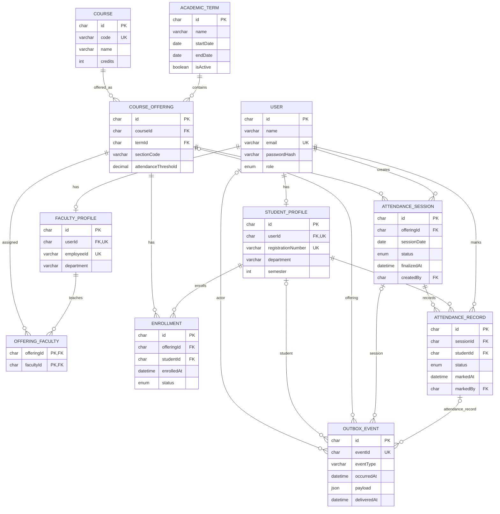

# Student Attendance Management System ER Diagram

The outbox's optional foreign keys to actor, student, offering, session, and attendance record are shown as optional references. Table and key names correspond to `prisma/schema.prisma` and `docs/schema.md`.
